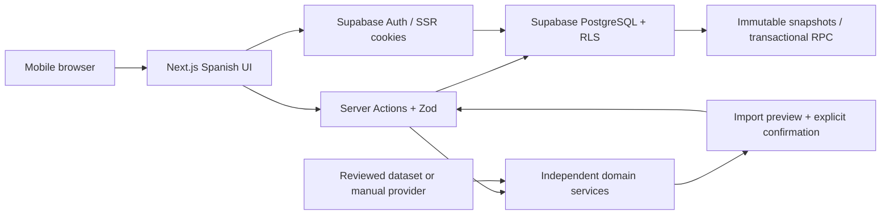

# Architecture and delivery plan

## Phase 0 inspection

The repository was an empty Git checkout on branch `work`, with no commits, source files, instructions or package constraints. Node 24, npm 11, Python 3.12 and Docker are available. No Supabase URL or key is injected. Use the existing checkout; do not create a worktree for cloud tasks.

## Decisions

- Next.js App Router, strict TypeScript, React and Tailwind. Server Components load private data; mutations use validated Server Actions or database functions. Small accessible UI primitives precede introducing a component library.
- Supabase PostgreSQL is authoritative. Supabase Auth uses cookie-based SSR and verified sessions. Public URL and publishable/anonymous key may be exposed; service-role keys must never reach browsers. No service-role key is needed for normal application operations.
- Domain code belongs in `src/domain`, provider contracts in `src/domain/cards.ts`, manual data adapters in `src/lib/data.ts`, database/auth adapters in `src/lib/supabase`. UI is Spanish; identifiers and technical documentation are English.
- The catalog starts empty. Manual entry is the initial provider fallback. No external dataset or artwork is assumed licensed, available or accurate. The active OPTCG API adapter needs no key; its availability, limits, provenance and image handling are reviewed in `OPTCG_API.md`. BerryWallet is retired.
- Card rows represent printings. `canonical_card_id` identifies shared rules identity across reprints; physical inventory references a printing. Version snapshots preserve leader, format, complete quantities and notes. Matches reference snapshots, never a mutable deck.
- Draft decks may be incomplete. The domain validator reports standard rules and dated format restrictions; active construction also requires known card colors. An empty restrictions table must never imply verified tournament legality.
- PWA foundation includes a manifest, local original icons and a conservative service worker. It does not cache authenticated responses or implement offline writes.

## Data flow

## Proposed database schema

| Entity                 | Ownership / integrity                                                                                                                           |
| ---------------------- | ----------------------------------------------------------------------------------------------------------------------------------------------- |
| cards                  | Shared rows read-only; manual rows owner-only and immutable; internal UUID, printed number, canonical identity, nullable details and provenance |
| card_restrictions      | Canonical identity, format, effective interval and provenance; read-only to users                                                               |
| decks                  | Owner, leader, tags, format/status; current version must belong to the same deck                                                                |
| deck_versions          | Parent-owned immutable leader/format snapshots; unique sequence per deck                                                                        |
| deck_cards             | Composite version/card key, positive quantity, separate main/DON roles; snapshot insertion through RPC                                          |
| matches                | Owner; exact owned version and leader opponent; win/loss/draw and play order                                                                    |
| tournaments            | Owner, selected deck version, dates and optional manual placement; archival preserves results                                                   |
| tournament_rounds      | Parent-owned, unique round; match and event owners must agree                                                                                   |
| collection_items       | Owner and physical printing; tradeable <= owned; language, finish and location                                                                  |
| collection_allocations | Parent-owned inventory reservation; total allocation <= owned minus tradeable; cannot allocate across owners                                    |
| import_jobs            | Owner, source, raw input, status and structured errors; no discarded unknown lines                                                              |

RLS protects every private table. Composite ownership foreign keys protect cross-entity relationships. Explicit privileges protect the catalog and snapshots. Deck-version saving uses one transaction and a row lock to serialize version numbers.

## Phases and acceptance

1. **Foundation:** runnable Spanish shell; mobile navigation; secure sign-in/sign-out; migration and RLS tests; manifest and service worker; build/typecheck/lint/unit/integration/mobile smoke commands.
2. **Cards and import:** provider contract/manual fallback; extensible parser; unknown/duplicate/error preview; explicit confirmation; persistent decks and text export.
3. **Builder and versions:** editable quantities/leader; structured validation; atomic immutable saves; comparisons; independent duplication and safe deletion/archive.
4. **Competitive tracking:** exact-version match entry; events/rounds; persisted analytics with W/(W+L), draw exclusion and sample counts.
5. **Practice:** injectable RNG; actual quantities; sampling without replacement; one configured mulligan; estimates labeled and reproducible.
6. **Collection/offline:** printing inventory, exclusive allocations and missing counts; only then design offline retry/conflict policies.

Each phase requires executed build, type check, lint and relevant tests, mobile loading/empty/error states and updated setup/status documentation. Passing phase 1 does not claim the full MVP is complete. Phase-specific domain and E2E tests are added alongside each feature.

## Risks and external dependencies

- Production requires an owner-provided Supabase project, public connection configuration, applied migrations, email confirmation/SMTP and redirect allowlists. Local development can use Supabase CLI + Docker without an external account.
- Cloud Docker/image pulling and browser installation may require network domains beyond package registries. Diagnose actual failures before changing network policy.
- RLS, transactional saves, version immutability and nested ownership need executable database tests, not just SQL inspection.
- Restrictions and data licensing require verified sources; legal status stays unverified without them.
- Vercel deployment requires a connected account/project. No deployment is claimed by a local build.
- Account export/deletion, production email, rate limiting and private feature flows remain release gates for subsequent phases; do not expose unfinished actions as functioning features.

## Competitive workflow decisions

- Manual cards are private rows in the printing catalog. Authenticated insert policy fixes provenance to manual and forbids image URLs; updates/deletes are not granted. Historical snapshots consequently retain the same facts. Canonical IDs join reprints; the validator also bridges identical printed codes when a future shared dataset overlaps manual roots.
- Import syntax normalization is independent of React and of provider persistence. Every preview stores its own raw text/error report. Browser CRLF is normalized to LF before auditing and confirmation; unknown/malformed lines prevent saving until explicitly corrected. Ordinary previews use only persisted cards. Explicit OPTCG API resolution fetches unknown codes with bounded requests and chooses a unique identified base printing; ambiguous variants stay unresolved. Provider notices are retained with each audit.
- `save_deck` combines parent creation/metadata, complete immutable version insertion and import confirmation in one transaction. Parent row locks serialize versions; an expected-version token prevents stale edits, while metadata-only changes do not make a redundant snapshot. A new version includes a structured change summary at insertion time; immutable rows are never patched later.
- Match IDs are fixed per form submission. `save_match` atomically commits a match and optional round; retrying the same ID updates rather than duplicates. Unique event/round numbers and owner/version/format guards roll back conflicting submissions. Archive blocks new rounds while preserving history and permitting corrections of existing games.
- Statistics derive from fully paginated persisted rows and expose accessible data tables alongside Recharts. Win rate excludes draws, all percentages disclose decisive sample counts, and five decisive games is a context threshold rather than a claim of statistical significance. Match entry explicitly uses UTC; history and monthly charts use Europe/Madrid.
- Construction validation is independent of UI. Drafts may have explained count/color/copy errors, but wrong roles/types and unknown cards are never persisted through the application. No verified complete restriction dataset is installed, so active status never certifies tournament legality.
- Local startup replays pending additive migrations without resetting existing data. Fresh application SQL is tested in a disposable PostgreSQL database with minimal Supabase Auth fixtures; separate integration/E2E flows exercise the real local Supabase Auth/API. This does not claim hosted Supabase, Codespaces provisioning or Windows browser validation.

## Historical BerryWallet adapter decisions (retired)

- `src/domain/berrywallet.ts` normalizes documented responses with Zod and an injectable HTTP transport. Network/schema/quota failures produce bounded Spanish errors without upstream content or keys. `src/lib/berrywallet.ts` is server-only and implements `CardProvider`; it respects selected-set pagination without bulk mirroring the entire catalog.
- The migration adds an opaque `cards.provider_card_id` separate from UUID and printed code. `card_provider_items` holds private image references, separate EUR/USD quotes and consultation timestamps. Composite ownership FK and SELECT-only RLS isolate the cache. An authenticated transaction-safe RPC ignores caller ownership fields, idempotently caches printings and preserves immutable card facts. Only quote/image metadata is refreshed.
- Images require a real authenticated session and an owned provider reference, with a fixed provider host, strict path/type/size bounds, no redirects and no permanent/shared storage. Alternate artworks retain their exact provider identity; opaque-ID image support remains a live verification gate.
- Search is documented as TCGPlayer-only; individual search imports use English. Japanese collection loading validates provider collection language and set metadata. Price refresh derives language from the stored card rather than trusting a posted value. No Pro price endpoint or subscription is activated.
- The current key binding exists but protected requests return 401. Offline unit fixtures, real PostgreSQL RLS/cache tests and mobile cached/fallback flows do not imply live provider acceptance.

## OPTCG API adapter decisions

- The active `OptcgProvider` implements `CardProvider`, with an injectable `OptcgClient` and Zod normalization independent of React. Group-specific documented GET endpoints cover sets, starter decks, promos and DON. There are no credentials, new dependencies, scraping or automatic full-catalog jobs.
- `optcg_card_items` is an additional owned SELECT-only RLS cache; historical BerryWallet cache/identities stay intact. Its authenticated transaction preserves immutable card facts and canonical printed-code roots, deriving all ownership from `auth.uid()`. Prices/image links and source date can refresh independently. Composite owner FK, serialized identities and idempotent provider keys prevent cross-owner links and repeat import duplication.
- Provider image IDs identify variants. When missing, a documented deterministic local fingerprint uses provenance/name/code (never changing prices/effect text). Duplicate ambiguous identities are excluded and reported; renamed upstream records without IDs require manual review. Raw concatenated trait text stays one trait block rather than invented boundaries. Date-only provenance remains date-only in quote UI.
- Import review explicitly resolves at most 15 codes. A unique documented base printing takes precedence; otherwise only a unique exact code match is eligible. Unknown/malformed/ambiguous entries still block confirmation; every review retains text and provider notices.
- Public upstream JSON is cached for a bounded configurable duration (default one hour). Authoritative private persistence remains Supabase. The image route authenticates before owner-cache lookup and permits only HTTPS provider-host image paths, valid raster MIME types and bounded streams. It neither contacts retired BerryWallet nor stores image files permanently.
- Quote amounts lack a currency field in the verified API; the UI declares this and never assigns EUR/USD. Provider source date is shown separately from consultation date and stale values are not described as live ticks. Historical BerryWallet EUR/USD quotes remain readable without refresh.
- Ordinary browser tests preload a provider-specific synthetic transport only in the test server, with metadata cache disabled. Production/development launchers never load it. A separate opt-in real-browser smoke verification uses actual OPTCG API responses and cleans up its dedicated local account.
