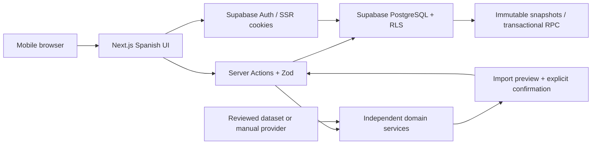

# Architecture and delivery plan

## Phase 0 inspection

The repository was an empty Git checkout on branch `work`, with no commits, source files, instructions or package constraints. Node 24, npm 11, Python 3.12 and Docker are available. No Supabase URL or key is injected. Use the existing checkout; do not create a worktree for cloud tasks.

## Decisions

- Next.js App Router, strict TypeScript, React and Tailwind. Server Components load private data; mutations use validated Server Actions or database functions. Small accessible UI primitives precede introducing a component library.
- Supabase PostgreSQL is authoritative. Supabase Auth uses cookie-based SSR and verified sessions. Public URL and publishable/anonymous key may be exposed; service-role keys must never reach browsers. No service-role key is needed for normal application operations.
- Domain code belongs in `src/domain`, provider contracts in `src/domain/cards.ts`, manual data adapters in `src/lib/data.ts`, database/auth adapters in `src/lib/supabase`. UI is Spanish; identifiers and technical documentation are English.
- The private persisted catalog starts empty. Cartas automatically browses available public English provider metadata with authenticated paginated results; previous manual facts remain readable, while missing provider cards stay explicit unknowns. No external dataset or artwork is assumed licensed, available or accurate. The active OPTCG API adapter needs no key; its availability, limits, provenance and image handling are reviewed in `OPTCG_API.md`. BerryWallet is retired.
- Card rows represent printings. `canonical_card_id` identifies shared rules identity across reprints; physical inventory references a printing. Version snapshots preserve leader, format, complete quantities and notes. Matches reference snapshots, never a mutable deck.
- Draft decks may be incomplete. The domain validator reports standard rules and dated format restrictions; active construction also requires known card colors. An empty restrictions table must never imply verified tournament legality.
- PWA foundation includes a manifest, local original icons and a conservative service worker. It does not cache authenticated responses or implement offline writes.

## Data flow

## Proposed database schema

| Entity                 | Ownership / integrity                                                                                                                           |
| ---------------------- | ----------------------------------------------------------------------------------------------------------------------------------------------- |
| cards                  | Shared rows read-only; manual rows owner-only and immutable; internal UUID, printed number, canonical identity, nullable details and provenance |
| card_restrictions      | Canonical identity, format, effective interval and provenance; read-only to users                                                               |
| decks                  | Owner, leader, tags, format/status; current version must belong to the same deck                                                                |
| deck_versions          | Parent-owned immutable leader/format snapshots; unique sequence per deck                                                                        |
| deck_cards             | Composite version/card key, positive quantity, separate main/DON roles; snapshot insertion through RPC                                          |
| matches                | Owner; exact owned version and leader opponent; win/loss and play order; historical unsupported values retained                                 |
| tournaments            | Owner, selected deck version, dates and optional manual placement; archival preserves results                                                   |
| tournament_rounds      | Parent-owned, unique round; match and event owners must agree                                                                                   |
| collection_items       | Owner and physical printing; tradeable <= owned; language, finish and location                                                                  |
| collection_allocations | Parent-owned inventory reservation; total allocation <= owned minus tradeable; cannot allocate across owners                                    |
| wishlist_items         | Owner and exact printing; unique owner/card; total English-copy goal, priority, notes; optimistic timestamp updates                             |
| import_jobs            | Owner, source, raw input, status and structured errors; no discarded unknown lines                                                              |

RLS protects every private table. Composite ownership foreign keys protect cross-entity relationships. Explicit privileges protect the catalog and snapshots. Deck-version saving uses one transaction and a row lock to serialize version numbers.

## Phases and acceptance

1. **Foundation:** runnable Spanish shell; mobile navigation; secure sign-in/sign-out; migration and RLS tests; manifest and service worker; build/typecheck/lint/unit/integration/mobile smoke commands.
2. **Cards and import:** provider contract/manual fallback; extensible parser; unknown/duplicate/error preview; explicit confirmation; persistent decks and text export.
3. **Builder and versions:** editable quantities/leader; structured validation; atomic immutable snapshots for recorded games and safe confirmed deletion; product history/compare/duplicate/archive controls were subsequently retired at the owner's request.
4. **Competitive tracking:** exact-version match entry; events/rounds; persisted analytics with W/(W+L), explicit win/loss sample counts.
5. **Practice:** injectable RNG; actual quantities; sampling without replacement; one configured mulligan; estimates labeled and reproducible.
6. **Collection/offline:** printing inventory, exclusive allocations, missing counts and exact-art wishlist are implemented. Offline retry/conflict policies remain a later deliverable.

Each phase requires executed build, type check, lint and relevant tests, mobile loading/empty/error states and updated setup/status documentation. Passing phase 1 does not claim the full MVP is complete. Phase-specific domain and E2E tests are added alongside each feature.

## Risks and external dependencies

- Production requires an owner-provided Supabase project, public connection configuration, applied migrations, email confirmation/SMTP and redirect allowlists. Local development can use Supabase CLI + Docker without an external account.
- Cloud Docker/image pulling and browser installation may require network domains beyond package registries. Diagnose actual failures before changing network policy.
- RLS, transactional saves, version immutability and nested ownership need executable database tests, not just SQL inspection.
- Restrictions and data licensing require verified sources; legal status stays unverified without them.
- Vercel deployment requires a connected account/project. No deployment is claimed by a local build.
- Account export/deletion, production email, rate limiting and private feature flows remain release gates for subsequent phases; do not expose unfinished actions as functioning features.

## Competitive workflow decisions

- Manual cards are private rows in the printing catalog. Authenticated insert policy fixes provenance to manual and forbids image URLs; updates/deletes are not granted. Historical snapshots consequently retain the same facts. Canonical IDs join reprints; the validator also bridges identical printed codes when a future shared dataset overlaps manual roots.
- Import syntax normalization is independent of React and of provider persistence. Every preview stores its own raw text/error report. Browser CRLF is normalized to LF before auditing and confirmation; unknown/malformed lines prevent saving until explicitly corrected. Ordinary previews use only persisted cards. Explicit OPTCG API resolution fetches unknown codes with bounded requests and chooses a unique identified base printing; ambiguous variants stay unresolved. Provider notices are retained with each audit.
- `save_deck` combines parent creation/metadata, complete immutable version insertion and import confirmation in one transaction. Parent row locks serialize versions; an expected-version token prevents stale edits, while metadata-only changes do not make a redundant snapshot. A new version includes a structured change summary at insertion time; immutable rows are never patched later.
- Match IDs are fixed per form submission. `save_match` atomically commits a match and optional round; retrying the same ID updates rather than duplicates. Unique event/round numbers and owner/version/format guards roll back conflicting submissions. Archive blocks new rounds while preserving history and permitting corrections of existing games.
- Statistics derive from fully paginated persisted rows and expose accessible data tables alongside Recharts. Win rate uses wins and losses, all percentages disclose their sample counts, and five decisive games is a context threshold rather than a claim of statistical significance. Match entry explicitly uses UTC; history and monthly charts use Europe/Madrid.
- Construction validation is independent of UI. Incomplete lists may retain explained count/color issues, but wrong roles/types, unknown cards and copy-limit violations are never persisted through the application. No product status is exposed and no verified complete restriction dataset is installed; saved construction does not certify tournament legality.
- Local startup replays pending additive migrations without resetting existing data. Fresh application SQL is tested in a disposable PostgreSQL database with minimal Supabase Auth fixtures; separate integration/E2E flows exercise the real local Supabase Auth/API. This does not claim hosted Supabase, Codespaces provisioning or Windows browser validation.

## Historical BerryWallet adapter decisions (retired)

- `src/domain/berrywallet.ts` normalizes documented responses with Zod and an injectable HTTP transport. Network/schema/quota failures produce bounded Spanish errors without upstream content or keys. `src/lib/berrywallet.ts` is server-only and implements `CardProvider`; it respects selected-set pagination without bulk mirroring the entire catalog.
- The migration adds an opaque `cards.provider_card_id` separate from UUID and printed code. `card_provider_items` holds private image references, separate EUR/USD quotes and consultation timestamps. Composite ownership FK and SELECT-only RLS isolate the cache. An authenticated transaction-safe RPC ignores caller ownership fields, idempotently caches printings and preserves immutable card facts. Only quote/image metadata is refreshed.
- Images require a real authenticated session and an owned provider reference, with a fixed provider host, strict path/type/size bounds, no redirects and no permanent/shared storage. Alternate artworks retain their exact provider identity; opaque-ID image support remains a live verification gate.
- Search is documented as TCGPlayer-only; individual search imports use English. Japanese collection loading validates provider collection language and set metadata. Price refresh derives language from the stored card rather than trusting a posted value. No Pro price endpoint or subscription is activated.
- The current key binding exists but protected requests return 401. Offline unit fixtures, real PostgreSQL RLS/cache tests and mobile cached/fallback flows do not imply live provider acceptance.

## OPTCG API adapter decisions

- The active `OptcgProvider` implements `CardProvider`, with an injectable `OptcgClient` and Zod normalization independent of React. Group-specific documented GET endpoints cover sets, starter decks, promos and DON. There are no credentials, new dependencies, scraping or persistent full-catalog import jobs. Opening Cartas reads available public datasets into a bounded server-process metadata cache; it does not create private cards.
- `optcg_card_items` is an additional owned SELECT-only RLS cache; historical BerryWallet cache/identities stay intact. Its authenticated transaction preserves immutable card facts and canonical printed-code roots, deriving all ownership from `auth.uid()`. Prices/image links and source date can refresh independently. Composite owner FK, serialized identities and idempotent provider keys prevent cross-owner links and repeat import duplication.
- Provider image IDs identify variants. When missing, a documented deterministic local fingerprint uses provenance/name/code (never changing prices/effect text). Duplicate ambiguous identities are excluded and reported; renamed upstream records without IDs require manual review. Raw concatenated trait text stays one trait block rather than invented boundaries. Date-only provenance remains date-only in quote UI.
- Import review explicitly resolves at most 15 codes. A unique documented base printing takes precedence; otherwise only a unique exact code match is eligible. Unknown/malformed/ambiguous entries still block confirmation; every review retains text and provider notices.
- Public upstream JSON is cached for a bounded configurable duration (default one hour). Authoritative private persistence remains Supabase. The image route authenticates before owner-cache lookup and permits only HTTPS provider-host image paths, valid raster MIME types and bounded streams. It neither contacts retired BerryWallet nor stores image files permanently.
- Quote amounts lack a currency field in the verified API; catalog/raw-provider UI declares this. Decks use the owner-requested USD display with a visible asterisk and source disclaimer, without modifying the stored null currency or converting amounts. Provider source date is shown separately from consultation date and stale values are not described as live ticks. Historical BerryWallet EUR/USD quotes remain readable without refresh.
- Ordinary browser tests preload a provider-specific synthetic transport only in the test server, with metadata cache disabled. Production/development launchers never load it. A separate opt-in real-browser smoke verification uses actual OPTCG API responses and cleans up its dedicated local account.

## Visual builder interaction

- A controlled gallery presents English leader selection separately from main/DON quantity editing. Responsive card tiles use authentic source artwork, explicit variant quantities, accessible 44px controls, a main-deck counter and four visible primary filters. Candidate previews remain transient; selection persists only the actual chosen printing while deck save/version semantics stay unchanged.
- Default browsing uses documented type/set endpoints and bounded 24-candidate pages. Source totals are not invented and artwork is lazy; malformed/missing images use placeholders. Filters/counts and canonical copy validation stay independent of presentation. Historical non-English facts remain stored and existing selected leaders remain editable; the current gallery restricts new selections to English.
- Public-art previews use an authenticated fixed-host transient route, distinct from ownership-checked private card artwork. Both use streaming size/type/path bounds and no permanent/shared storage. This adds no tables, migrations, credentials or dependencies.

## Home dashboard selection and history

- The authenticated server page reads fully paginated owned decks, immutable versions, version entries, catalog and matches through the existing RLS-protected client. It does not request tournament/round data or a fresh external catalog. Existing loading/error boundaries apply; cached provider artwork uses the existing authenticated image route.
- `src/domain/dashboard.ts` builds a serializable read model independent of React. Canonical identities group current leaders of all saved decks, including legacy archived records across alternate printings. Match attribution uses the leader in the exact immutable played version, including archived lists and prior leaders. Overall counts preserve all saved games; limiting recent previews to six never limits chart samples.
- Client state selects a leader and, independently, one of that leader's current decks for its curve. Switching leaders resets the deck selection. The curve reads only the selected current version's main entries, weights by quantities, retains cost zero and a separate unknown-cost bucket, and excludes DON/leader cards. Its quick match action supplies the exact version ID. No database writes or source fact mutations occur during selection.
- Summary and charts reuse the documented W/(W+L) convention, expose the decisive sample size, label small samples and use Madrid dates/month boundaries. Accessible text/list/table equivalents accompany charts; empty accounts, incomplete-list curves and absent results show explicit next actions. This feature requires no schema, credential, dependency or deployment change.

## Guided creation and current outcome rules

- Creation has explicit leader, compatible card and name steps. Parent-controlled metadata, quantities and import review survive back navigation. Editing retains direct list/metadata controls. Import preview remains optional and audited; unknown/malformed lines never disappear or auto-save. Imported incompatible lists retain every entry and display domain issues.
- `src/domain/deck-builder.ts` computes shared canonical copy budgets, main/DON size budgets and color compatibility independently of React. Remote candidates bridge by printed number before caching; persisted alternate/reprint identities use canonical groups. Increases are bounded; decreasing an invalid historical/import quantity never silently discards extra copies. The authenticated save action rejects copy-limit violations for all saved lists.
- Named expansion metadata is normalized from documented public set/starter lists, with safe code fallback and no hardcoded names. The authenticated builder search action validates every control and bounds family/color requests. It uses documented color/name/set/cost filters, unions dual colors, deduplicates exact provider printings and stops on network/quota/server failure. UI re-filters actual returned facts; cached JSON remains public and private persistence stays separate.
- New match outcomes are win/loss in Zod and additive database triggers. The historical PostgreSQL enum remains intact to preserve existing snapshots/matches/rounds. Old unsupported rows can be retained/updated or explicitly corrected; new unsupported outcomes and conversions into them are rejected. UI offers no third result and marks old records for review without inventing a replacement; old values never enter win/loss percentages or result bars.

## Printed-code groups and exact variant dialogs

- The gallery paginates printed-number groups rather than printings. A small domain service merges cached and remote identities, keeps immutable cached facts, deduplicates exact provider printings and chooses a known base representative without confusing canonical copy identity with artwork. Group totals reflect actual saved editor quantities; alternate/reprint quantities remain independent.
- Opening a group consults at most the three documented exact-code categories (one for DON), independently of expansion/name filters. Results are reused within the mounted editor; no source image files or additional private records are persisted by browsing. English/type/leader-color checks still apply to the expanded choices. Selecting an exact variant uses the existing owner-protected cache transaction; deck/version saving remains explicit and unchanged.
- A reusable native dialog handles top-layer display, focus containment/restoration, Escape/close, body scroll restoration and bounded mobile layout. While a requested add is pending, its dialog stays open and explains progress. Both artwork variants and leader enlargement use this component. The selected leader context displays the exact selected printing and its real colors, not a generic canonical artwork.

## Catalog exploration

- `src/domain/card-explorer.ts` combines exact owned/remote printing identities, applies primary/advanced filters to the full received dataset and paginates printed-number groups. Cached private card facts remain immutable. Expansion names and quotes refer to the exact source printing; absent names/prices are not invented. English choices only; previous stored history remains readable.
- `src/lib/public-catalog.ts` caches only public normalized metadata in one bounded in-memory snapshot per server process. It coalesces concurrent loads and respects `OPTCG_CACHE_SECONDS=0`; partial transport failures get at most 60 seconds. The bulk source paths bypass Next's smaller individual fetch-cache entry limit while retaining the 5 MB streamed-response bound. No images, account rows or credentials enter this cache.
- `browseCardCatalog` authenticates, validates every filter/page, reads saved facts under existing RLS, then returns at most 36 groups and options. Only visible saved printings missing source quotes request owned stored quote metadata. No service-role client or new database schema is involved.
- `CardExplorer` ignores superseded responses, debounces input and provides loading/error/empty/partial states. Native dialogs reuse existing focus/Escape/scroll behavior, show large exact artwork and read-only prices/details, and allow variant switching. Optional explicit save retains the established import transaction; catalog browsing does not allocate collection items or create decks. Advanced import tools and saved-card URLs remain accessible.

## Selected artwork price history

- `price-history.ts` normalizes only a unique exact provider printing's documented Day1–Day13 fields and latest quote. It preserves zero/null independently by metric, reports invalid values and refuses identity ambiguity. Date-only provenance does not imply individual observation dates or chronological direction; the chart preserves source-field order, shows gaps and avoids inferred percentage trends/calendar labels.
- `OptcgClient.priceHistory` uses only documented set/starter paths with the existing host/timeout/stream/JSON-cache protections. Promo and DON histories are explicitly unsupported. `getCardPriceHistory` authenticates and validates all untrusted selectors before network access, without reading or writing private account data.
- `CardPriceHistory` is shared by the catalog modal and saved-card detail. It lazily loads the selected printing, ignores superseded/unmounted responses and reuses a bounded one-minute mounted-dialog cache. Current card quotes/details survive history outages; retries are explicit. The chart has solid/dashed series, no null bridging and an accessible value table. Live endpoint HTTP 500 is an external limitation, not a successful live-history verification.

## Visual leader selection for match entry

- The match form resolves player artwork from the selected immutable `deck_versions.leader_card_id`, including tournament-locked versions and historical match editing. Changing the chosen version updates the exact artwork without rewriting old snapshots.
- `match-leaders.ts` merges owned/imported and public English leader candidates, groups by printed number and prefers a known base representative. Names alone/canonical roots do not merge distinct printed leaders. A sole available artwork remains an honest fallback; historical selected non-English/alternate IDs remain intact until explicitly changed.
- The authenticated leader-list action reads saved facts under existing RLS and reuses the bounded public catalog cache. The visual native dialog shows photo/name/code rows and searches all received choices before 24-row display pagination. Owned candidates appear immediately; source failure retains them with explicit retry and saved-card fallback. It never filters opposing leaders to the player's colors.
- Selecting a remote leader reuses the existing runtime-validated owned printing cache action and returns an actual UUID; browsing/closing/searching writes nothing. The controlled hidden opponent field and native modal preserve unsaved match metadata, result and play order. Enter in search cannot implicitly submit the surrounding match form; pending selection blocks leaving/duplicate clicks. Existing transactional match ownership and exact-version validation remain authoritative.

## Physical collection and wishlist decisions

- `collection_items` represents declared physical English copies per printing/finish/location. Virtual deck entries and wishlist goals never create ownership. `collection_allocations` reserves specific physical lots exclusively for owned decks; tradeable copies are unavailable for reservation. `wishlist_items` uses an exact immutable printing UUID, one total-copy goal per owner/printing, priority and notes. Wish progress includes all owned English copies, whereas playable availability excludes tradeable copies and allocations to other decks.
- `deckCollectionNeeds` and `planDeckAllocations` are UI-independent domain functions. Canonical groups bridge alternate artworks, reprints and identical printed numbers for playing requirements. Leader quantity one, main quantities and separate DON entries are included. Requirements aggregate before availability is calculated, so a physical lot cannot satisfy two requirements twice. Existing compatible reservations are preferred, followed by the list's exact artwork and deterministic lot order.
- `set_deck_allocations` runs as the authenticated invoker, locks the owned deck, verifies its expected current version and locks affected inventory lots in sorted order before replacing that deck's reservations atomically. Existing ownership foreign keys and capacity triggers reject foreign lots, tradeable/overallocated copies and concurrent overbooking. A failure rolls back the old allocation set. Deleting/reducing reserved inventory is blocked; account deletion can cascade consistently. Virtual edits retain reservations until explicitly adjusted/released. Legacy archive state remains a storage detail; unreferenced deck deletion cascades its reservations without removing inventory.
- `raise_wishlist_target` is an authenticated invoker upsert using the greater existing/requested goal; it preserves priority and notes. Adding a deck's deficit requests its represented artwork's current owned total plus missing copies, rather than repeatedly incrementing the goal. Different exact artworks have independent wishes even if they share a canonical playing identity. Fulfilled wishes remain until explicitly removed; their deletion does not change ownership.
- Collection actions validate references and payloads with strict Zod schemas and `requireUser`, then read/write through the user client and RLS. Merely opening controls does no import; an explicit inventory/wish mutation can use the existing validated selected-printing cache. Lists fully paginate private reads without a public cache. Client-generated stable IDs make create retries idempotent; edits/deletes compare expected `updated_at`. Inventory/wish timestamps use `clock_timestamp()` so sequential writes within one transaction still get distinct optimistic tokens.
- The reusable `CardOwnership` controls appear in exact-art catalog dialogs, saved-card detail and collection/wishlist rows. Opening rereads authoritative state, pending writes disable controls, conflicts retain edits with a refresh instruction, and destructive actions confirm. The physical-deck selector disables actions during route transitions and keys forms by deck/version, preventing stale hidden-form submissions while a different deck loads. Lists paginate presentation, offer empty/search/loading/error states and reuse artwork placeholders. No additional dependency, credential, permanent artwork storage, purchase action or offline queue is introduced.
- Tests cover canonical versus exact-art semantics, missing/available/reserved quantities, deterministic allocation, stale version/row tokens, atomic rollback, actual concurrent PostgreSQL reservations, owner/foreign/anonymous RLS, account cascades and a complete mobile browser flow. Ordinary provider metadata/artwork is synthetic and dedicated test accounts are cleaned up.

## Play-order percentages

`buildAnalytics` always returns first/second groups in that order, including zero-game groups. Each group calculates win and loss rates against its own wins-plus-losses count; absent/unsupported-only samples return null rates. Global results and other groups keep their existing conventions. The shared `PlayOrderResults` component presents both rates, counts and the actual sample, plus the existing chart/table of quantities, in Statistics and the selected-leader dashboard. Statistics passes the already deck/format-filtered records; the dashboard passes only the selected canonical leader's immutable historical versions. This is derived from saved matches with no schema change, additional provider request or cached private aggregate.

## Visual deck pricing and printing details

- Deck detail retains the owned current immutable list and renders one artwork tile per exact printing, with leader first, main cards sorted by cost and DON separated. `buildDeckDisplay` is a framework-independent domain function: it matches private saved quotes by both internal card UUID and exact provider identity/source, uses only a unique valid OPTCG market metric and multiplies by real saved quantities. Canonical/reprint grouping never substitutes a cheaper or available artwork price. Other currencies/sources and inventory metrics are not blended into the valuation.
- Decimal source-number representations are converted to integer coefficients/scales for exact line multiplication and summation, including scientific notation and real zero. Serialized totals use decimal strings; Spanish formatting does not round tiny positive source values to zero or expose BigInt in the page payload. Summaries retain priced/total copies and printings, completeness, oldest used consultation and leader/main/DON subtotals. Missing prices produce an explicit partial subtotal or absent amount, not a fabricated complete total.
- `getDeckQuotes` reads only selected deck card UUIDs, deduplicated in bounded batches below API row limits. Authentication and owned-deck lookup precede access; RLS remains authoritative. A quote-read error discards partial results and supplies an actionable error alongside the intact list. No public cache contains private deck/price rows, and opening the page introduces no external metadata request, import or inventory write.
- The client `DeckGallery` reuses `CardArtwork`, native `Modal`, `OptcgPrices`, ownership controls and the bounded history cache. It exposes exact unit/line prices, responsive two-to-six-column artwork, accessible previous/next controls, focus/Escape/background-scroll behavior and honest missing-image/data states. Opening the history section alone mounts its existing read-only source request. Explicit quote refresh uses the established owner-authorized action and cache TTL; refreshed quotes affect valuation without changing historical card facts or deck snapshots.

## Simplified deck workflows

- Creation and text import are distinct authorized routes: `/decks/new` retains leader/cards/name, `/decks/import` starts with text preview and an explicit continue step, then card adjustment/name/confirmation. The creation/editor view has no import panel. Unknown/malformed/duplicate input remains explicit and raw previews remain privately audited. Import without a leader can proceed to choosing one in the card step; no hidden save bypasses preview confirmation.
- Product deck statuses, filters, badges and archive/restore/duplicate controls are removed. The SQL column/enum and historical snapshots remain for storage compatibility and match/tournament integrity. The save action fixes the internal status to draft and notes to an empty value regardless of posted fields, while domain/card-copy validation stays authoritative. All legacy decks participate in library/home/selection flows; no silent migration or destructive reset changes them. Retired import/version-history URLs authorize then redirect; the legacy deck compare URL opens statistics with the owned deck preselected; their database records remain intact.
- The library defaults to larger artwork tiles with an optional compact view. Deck detail has a single header containing leader/name, right-aligned price with adjacent export trigger, edit and red confirmed delete controls. The previous standalone valuation/validation/export/operation panels are removed from detail; construction explanations remain in the editor.
- USD is an explicit user-requested display denomination, not a provider capability. Source review still finds no documented currency field/confirmation. Stored quote currency remains null, numeric sums remain unchanged, no conversion is performed and the header asterisk links to price coverage/source/freshness details. Missing quotes remain visibly partial and real zero remains zero. Catalog/raw-provider quote components retain their source-currency uncertainty.
- Plain-text export aggregates exact printed numbers per role, includes one leader then main/DON quantities and emits no comments. The export dialog copies those exact bytes via Clipboard API; denied access selects the text with a recovery message. Modal focus/Escape/scroll/pending guards remain shared. The owner-authorized delete action only accepts confirmed deletion; foreign-key guards reject decks with recorded games/events with an actionable message and preserve all linked history. Unreferenced deletion is atomic and does not remove catalog/collection ownership.

## Two-deck statistics comparison

- `/statistics/compare` requires authentication and uses the fully paginated, RLS-protected competitive workspace. Only owned decks enter selectors; selected IDs must be valid, distinct and present in that workspace. Malformed/repeated query parameters and reversed/invalid dates fail explicitly. A missing selection defaults to two distinct owned decks; a supplied unknown/foreign ID never falls back to another deck’s results. Legacy `/decks/[deckId]/compare` first authorizes the deck and then redirects with `a` preselected.
- `src/domain/deck-comparison.ts` applies one shared format and inclusive Madrid calendar-day interval to both decks. Immutable match-version references resolve the owning deck; previous lists remain included without exposing version-history UI. Canonical leader identities bridge opponent artworks/reprints before aggregation. Rival/month cohorts align across both sides, retaining real zero counts and absent percentages for the missing side. Input records are not mutated.
- Server-rendered summaries, accessible result tables and the existing count chart show each cohort’s own denominator, both win/loss percentages, first/second records, matchup and monthly results. Small samples are explicit and no winner is inferred. Current portraits are labeled to distinguish them from historical played leaders. Private records are never publicly cached; ordinary comparison performs no writes or external provider requests. Shared private-route loading/error handling remains in effect.
- The general Statistics page no longer renders a version chart. Internal snapshot identities/analytics and import audit rows remain to preserve recorded games and transactional integrity. No SQL schema/data reset is needed for this UI/read-model change.

## Compact import and streamlined card selection

- The parser already accepts adjacent quantity multipliers (`4xOP17-113`). A regression fixture retains the owner’s exact sixteen-code list (one leader, fifty main cards), including its trailing whitespace. Tests attach only explicitly synthetic facts to these printed codes.
- The import review now resolves absent private-catalog entries automatically through the reviewed provider adapter, with a sequential twenty-code ceiling per review and existing public-response cache/timeout safeguards. Missing, ambiguous and malformed records remain visible and block confirmation; retries preserve raw input and private audits. Deck save still requires preview and explicit confirmation. No provider capability or card fact is invented.
- Card-step navigation is rendered inside the selected-leader context through a reusable ReactNode slot. Changing the imported leader opens leader selection in that same step and retains quantities. Selected incompatible main cards remain visible/removable in their variant dialogs; adding more is blocked until the leader is compatible. DON browsing, compatibility/available-total captions, the extra editor-content panel and card-step validation card are retired. The compact main count and exact-art variant quantity controls remain; structured construction issues appear at save/name review. Historical/imported DON entries are preserved in storage/export rather than silently discarded.
- Manual-card form and its application server action are removed, together with creation links and fallback instructions throughout the builder, import, catalog and rival picker. The former `/cards/new` route authenticates then redirects to Cartas. Existing owner-only manual rows, database policies and immutable snapshots remain compatible; provider caching is still available and does not declare physical ownership.
