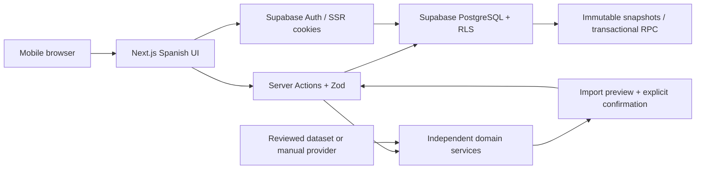

# Architecture and delivery plan

## Phase 0 inspection

The repository was an empty Git checkout on branch `work`, with no commits, source files, instructions or package constraints. Node 24, npm 11, Python 3.12 and Docker are available. No Supabase URL or key is injected. Use the existing checkout; do not create a worktree for cloud tasks.

## Decisions

- Next.js App Router, strict TypeScript, React and Tailwind. Server Components load private data; mutations use validated Server Actions or database functions. Small accessible UI primitives precede introducing a component library.
- Supabase PostgreSQL is authoritative. Supabase Auth uses cookie-based SSR and verified sessions. Public URL and publishable/anonymous key may be exposed; service-role keys must never reach browsers. No service-role key is needed for normal application operations.
- Domain code belongs in `src/domain`, provider contracts in `src/providers`, database/auth adapters in `src/lib/supabase`. UI is Spanish; identifiers and technical documentation are English.
- The catalog starts empty. Manual entry is the initial provider fallback. No external dataset or artwork is assumed licensed, available or accurate. A future adapter needs a documented terms/license/rate-limit review.
- Card rows represent printings. `canonical_card_id` identifies shared rules identity across reprints; physical inventory references a printing. Version snapshots preserve leader, format, complete quantities and notes. Matches reference snapshots, never a mutable deck.
- Draft decks may be incomplete. The domain validator will report standard rules and dated format restrictions in phase 2/3. An empty restrictions table must never imply verified tournament legality.
- PWA foundation includes a manifest, local original icons and a conservative service worker. It does not cache authenticated responses or implement offline writes.

## Data flow

## Proposed database schema

| Entity                 | Ownership / integrity                                                                                                                            |
| ---------------------- | ------------------------------------------------------------------------------------------------------------------------------------------------ |
| cards                  | Authenticated read-only catalog; internal UUID, printed number, canonical printing reference, nullable type-specific details and source metadata |
| card_restrictions      | Canonical identity, format, effective interval and provenance; read-only to users                                                                |
| decks                  | Owner, leader, tags, format/status; current version must belong to the same deck                                                                 |
| deck_versions          | Parent-owned immutable leader/format snapshots; unique sequence per deck                                                                         |
| deck_cards             | Composite version/card key, positive quantity, separate main/DON roles; snapshot insertion through RPC                                           |
| matches                | Owner; exact owned version and leader opponent; win/loss/draw and play order                                                                     |
| tournaments            | Owner, selected deck version, dates and optional manual placement; archival preserves results                                                    |
| tournament_rounds      | Parent-owned, unique round; match and event owners must agree                                                                                    |
| collection_items       | Owner and physical printing; tradeable <= owned; language, finish and location                                                                   |
| collection_allocations | Parent-owned inventory reservation; total allocation <= owned minus tradeable; cannot allocate across owners                                     |
| import_jobs            | Owner, source, raw input, status and structured errors; no discarded unknown lines                                                               |

RLS protects every private table. Composite ownership foreign keys protect cross-entity relationships. Explicit privileges protect the catalog and snapshots. Deck-version saving uses one transaction and a row lock to serialize version numbers.

## Phases and acceptance

1. **Foundation:** runnable Spanish shell; mobile navigation; secure sign-in/sign-out; migration and RLS tests; manifest and service worker; build/typecheck/lint/unit/integration/mobile smoke commands.
2. **Cards and import:** provider contract/manual fallback; extensible parser; unknown/duplicate/error preview; explicit confirmation; persistent decks and text export.
3. **Builder and versions:** editable quantities/leader; structured validation; atomic immutable saves; comparisons; independent duplication and safe deletion/archive.
4. **Competitive tracking:** exact-version match entry; events/rounds; persisted analytics with W/(W+L), draw exclusion and sample counts.
5. **Practice:** injectable RNG; actual quantities; sampling without replacement; one configured mulligan; estimates labeled and reproducible.
6. **Collection/offline:** printing inventory, exclusive allocations and missing counts; only then design offline retry/conflict policies.

Each phase requires executed build, type check, lint and relevant tests, mobile loading/empty/error states and updated setup/status documentation. Passing phase 1 does not claim the full MVP is complete. Phase-specific domain and E2E tests are added alongside each feature.

## Risks and external dependencies

- Production requires an owner-provided Supabase project, public connection configuration, applied migrations, email confirmation/SMTP and redirect allowlists. Local development can use Supabase CLI + Docker without an external account.
- Cloud Docker/image pulling and browser installation may require network domains beyond package registries. Diagnose actual failures before changing network policy.
- RLS, transactional saves, version immutability and nested ownership need executable database tests, not just SQL inspection.
- Restrictions and data licensing require verified sources; legal status stays unverified without them.
- Vercel deployment requires a connected account/project. No deployment is claimed by a local build.
- Account export/deletion, production email, rate limiting and private feature flows remain release gates for subsequent phases; do not expose unfinished actions as functioning features.
