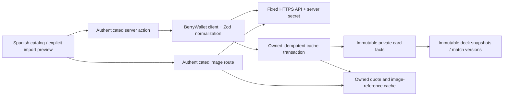

# BerryWallet integration review (retired)

OPTCG API supersedes this adapter. BerryWallet UI/actions and image requests have been removed; no current application route requires or uses its key. Historical private cards and quotes stay readable. The rest of this file records the original review and verification, not current setup instructions.

Reviewed on 2026-10-14 using the published One Piece guide, pricing page and terms:

- [Product](https://pokewallet.io/berrywallet)
- [One Piece API documentation](https://pokewallet.io/api-docs?game=op)
- [Plans and quotas](https://pokewallet.io/pricing)
- [Terms of service](https://pokewallet.io/terms-conditions)

## Scope and permission

Use the documented authenticated API at `https://api.pokewallet.io`, not scraped pages or undocumented website endpoints. The published service permits personal/commercial API use with an appropriate account/key and embeds; it does not transfer ownership of third-party card art. Metadata/quotes are cached to reduce calls as the API guide recommends. No copyrighted image files are committed or copied into permanent storage. Recheck provider terms and your plan before production/public distribution; a valid credential and actual responses remain release gates.

Free service documents 100 requests/hour and 1,000/day, shared across Pokémon and One Piece. Basic card metadata/search/images and included prices use that tier. Full raw/variant `/op/prices` requires Pro (published €20/month); Ultra is not necessary here. This implementation does not call paid price endpoints, enable trials or purchase plans. Quotas and prices can change.

## Data flow

`X-API-Key` stays on the server. Network-secret environments use a per-request proxy dispatcher; ordinary Supabase calls keep their existing transport. No upstream response/error content is logged or rendered. The browser receives normalized records, Spanish messages and transient image bytes. Responses are bounded to 5 MB while streaming; artwork accepts JPEG/PNG/WebP/AVIF, never SVG/HTML, redirects or arbitrary hosts. The private image route returns no-store/nosniff responses and checks RLS before requesting any artwork.

`cards.id` is the internal UUID; `provider_card_id` is the opaque external printing ID; `card_number` is the printed number. Alternate printings stay separate and share the canonical root for copy rules. Initial facts are never overwritten by later imports. `card_provider_items` isolates refreshed quotes and image references from historical card facts. Repeated imports are idempotent per owner/printing. The RPC derives ownership from `auth.uid()` and ignores client-provided owner/card IDs.

## Supported workflows and limits

- `/op/search` returns a paginated preview; details come from `/op/cards/:id` before saving. Search is documented as TCGPlayer-only and does not offer language filtering, so individual search imports use English. Japanese cards use collection loading with explicit, verified set language.
- `/op/sets/:code?language=...&page=...&limit=200` loads only the selected set; the provider's full `total`, received record count and actual set metadata determine completion. Maximum 25 pages per synchronization. Unsupported/missing card types, colors, numeric facts and prices are reported; they are not guessed. CardMarket-only records may lack playable-card facts and require manual entry.
- Import preview's explicit resolve action consults up to 15 distinct unknown codes. Only a unique exact code match from a complete search result is imported; multiple printings require selecting an edition in Cartas. Normal preview/saving never unexpectedly calls the provider. Unknown/malformed lines continue to block confirmation. Each review retains its raw input and provider notices.
- CardMarket amounts remain EUR; TCGPlayer amounts remain USD. Missing prices remain missing. No currency conversion, cross-set quote borrowing or invented zeros. `fetched_at` is our consultation time, not the vendor's price-update timestamp; published updates are daily, not guaranteed live ticks. Quote refresh reuses data younger than 15 minutes.
- Collection sync retains successfully cached pages when interrupted; retrying does not duplicate cards. Errors explain authentication, quota, network, incomplete pages and unsupported records. There are no automatic request retries, full-catalog background jobs, web scraping or paid endpoint calls. A batch stops on a zero remaining-hour header or 429. Simultaneous actions/images share the account's provider quota; no distributed quota coordinator is claimed.
- Images retain exact opaque printing IDs unless the provider supplies a valid image URL on the permitted host. Whether One Piece opaque variant IDs work on `/images/:id` has not been verified live. A missing image always uses a placeholder rather than artwork from another edition.
- Provider data does not certify current tournament restrictions. Manual fallback and persisted decks, matches, tournaments and analytics remain available without BerryWallet.

## Setup and current live verification

1. Create/review your API key in your BerryWallet/PokeWallet account. Check its status, game access and quota.
2. Store it only as `BERRYWALLET_API_KEY` in the cloud/deployment secret settings. For Windows/local development, use your ignored `.env.local`; never commit or send it in chat. Allow `api.pokewallet.io` in network-secret settings.
3. Apply the repository migrations using the existing database launcher or reviewed hosted migration workflow. Restart/rebuild the app after changing secrets. Search/add a known card, load one set, and verify metadata, prices and precise-printing artwork before claiming live completion.

In the current cloud the saved binding is present, its domain allowance is correct and public `/health` returned 200. Protected `/op/sets?language=en` and `/op/search` returned **401**. Both documented auth headers were tried; a Node request through the same proxy transport as the app also returned 401. No protected metadata, artwork or prices were obtained. The existing binding must be checked/renewed in the account and secure environment settings; the precise cause (key validity versus binding/account access) is not established. Environment publication is complete, but API authentication is not verified.

## Repeatable verification

`npm run check` runs lint, strict types, unit/real PostgreSQL tests and production build. Unit responses and pricing are synthetic. Tests cover normalization/nulls, malformed facts, opaque printing identities, URL/header security, HTTP errors, no retries, quota exhaustion, full-total pagination, partial-page retention, persistence failure, language mismatch and streaming image/JSON bounds. Real PostgreSQL tests cover owner isolation, spoofed ownership, idempotent refresh, immutable historical facts, canonical reprints, direct-write denial, exact deck references, anonymous denial and account cascading deletion. Fresh migration replay tests RLS on all 12 application tables.

`npm run test:e2e` requires a production build and local Supabase. Its server explicitly disables the provider credential; ordinary tests never rely on a live card website. Mobile tests seed only private synthetic records, verify cached EUR/USD prices and cooldown, authenticated image access/other-owner denial, fallback artwork, unknown-list preservation and audit notices, plus the existing deck/match/tournament/chart flows. Test accounts are removed afterward. These checks do not replace the outstanding authenticated live API verification.
